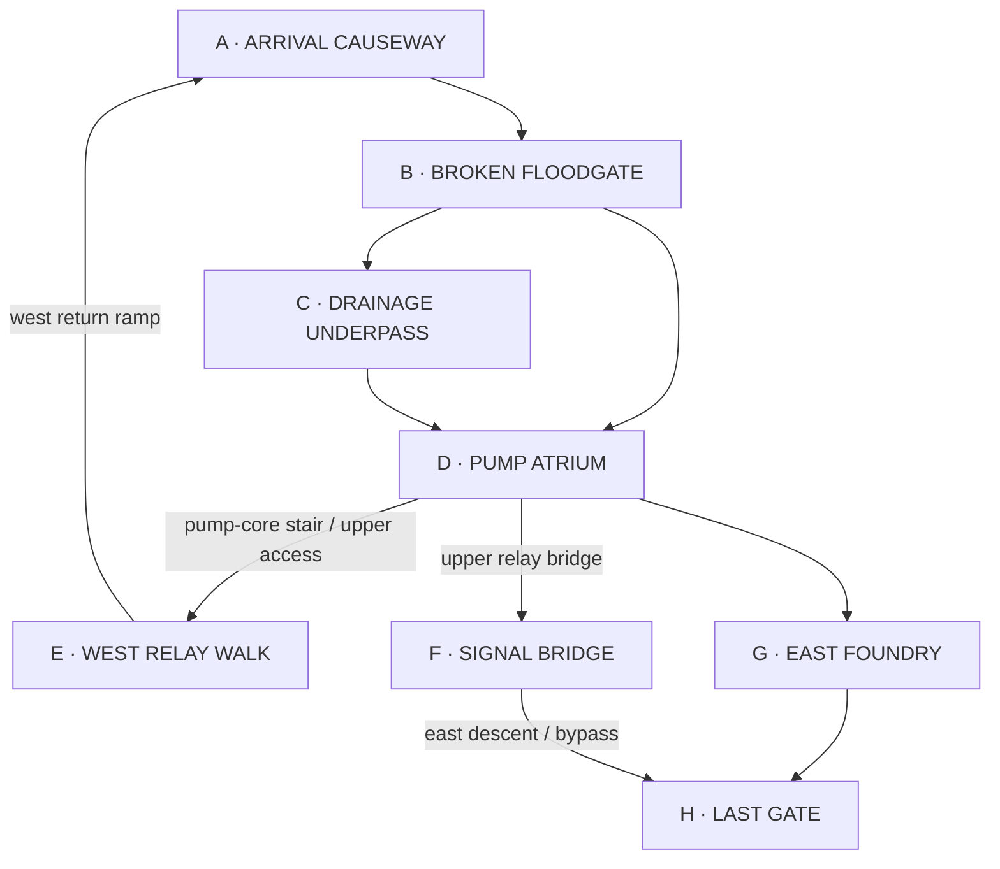

# OXYGEN — Sector 01 architecture

## Design intent

Sector 01 is a compact, legible district rather than a long sequence of isolated rooms. The player learns the ground route first, then discovers two parallel connections: a lower service route and an upper relay route. Both rejoin useful parts of the main path.

The design borrows structural principles from *The Messenger*'s Autumn Hills: clear forward movement, hazards that teach timing, a lower route that reveals a service/shop-like point of interest, and later use of a vertical traversal route to reach higher spaces. It does not reproduce the original geometry, enemies, names, or art.

## Room graph

## Room specification

| Room | World bounds / floor | Purpose | Entry → exit |
|---|---|---|---|
| A · Arrival Causeway | x=0–930, floor y=475 | Safe opening, introduce the visual language, give a view of the pump landmark | Spawn → B |
| B · Broken Floodgate | x=930–1790, floor y=475 | First meaningful route choice: jump the missing floor or deliberately drop into the service channel | A → D; optional drop to C |
| C · Drainage Underpass | x=1100–1800, floor y=690 | Optional lower bypass beneath the broken gate; contains a reward and a short climb back to the pump district | B → stepped exit → D |
| D · Pump Atrium | x=1790–2740, floor y=475 | The central landmark and true vertical junction; stair platforms wrap around the pump core | B/C → F or E |
| E · West Relay Walk | x=760–2740, floor y=135–245 | Upper return path; overlooks the opening area, exposes an early hidden alcove and descends back to A | D → west ramp → A |
| F · Signal Bridge | x=2740–3810, floor y=135 | Upper bypass across the East Foundry's floor hazard; contains a visible relay cache | D → east descent → H |
| G · East Foundry | x=2680–3700, floor y=475 | Main-line traversal test using a moving platform and a small hazard sequence | D → H; bypassed by F |
| H · Last Gate | x=3700–4850, floor y=475 | Final landing zone and exit; optional beacon mast leads to the last secret | G/F → exit |

## Why the climbs exist

1. **Drainage exit (y=690 to y=450):** gets the player back onto the main route after the lower underpass. It is a short stepped transition, not a vertical dead end.
2. **Pump stair (y=475 to y=135):** reaches the upper junction. From there the player can return west to the opening district or take the east bridge to bypass the Foundry.
3. **West return ramp (y=160 to y=475):** closes the upper loop back into the Arrival Causeway and lets the player approach the first obstacle from above.
4. **East bridge descent (y=135 to y=475):** returns the player to the final district beyond the Foundry hazard.
5. **Beacon mast (y=475 to y=100):** optional end-area climb whose purpose is a discoverable signal-vault secret and a final overlook.

## Research notes

Autumn Hills begins with a readable forward route and increasingly varied hazards. The walkthrough describes a lower descent to the first Shop Portal, which also functions as a checkpoint; the portal provides the Climbing Claws, after which the level uses climbable walls and more complex vertical sections. Later areas add underwater passages, additional shop/checkpoint moments, moving and swinging platforms, and a Power Seal detour. The reusable lesson is that the vertical traversal changes what routes are available and ties into a reward, bypass, or new connection—not simply that the map is tall.

## Implementation constraints

- Use OXYGEN's existing Level, Platform, MovingPlatform, camera, collision, checkpoint, secret, and exit systems.
- Keep the first 16 coin entries and the first four secret entries stable in save-index order where possible.
- Only common mechanics are required for the main route: ordinary jumps, the existing wall-jump-enabled sector flag, and the existing moving-platform support.
- No new unlock requirement, switch, key, or interaction system is introduced.
- The route graph and the platform graph are both tested; a nearby but unreachable ledge does not count as a valid secret.
